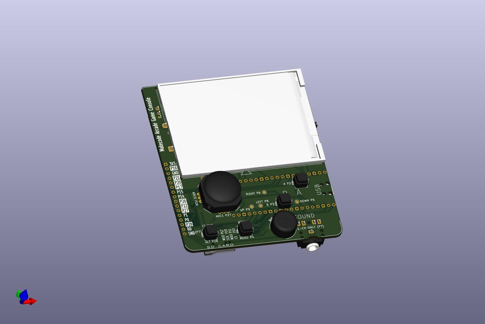

Please refer to:  
https://github.com/pondahai/makecode_arcade_console/tree/main/hardware/v2_3

  
  

## IO 定義表

以下依目前預設設定(LCD 為 ILI9341,與 Releases 的 `DOOM.uf2` 相同)整理,只列出實際使用的 GPIO。

| GPIO | 功能 | 方向 | 遊戲中的作用 |
|---|---|---|---|
| 2 | 按鍵 A | 輸入 | 使用/開門 + 跑步(Space + 左 Shift) |
| 3 | 按鍵 B | 輸入 | 開火(右 Ctrl) |
| 4 | 按鍵 START | 輸入 | 選單確認 + 自動地圖(Enter + Tab) |
| 5 | 按鍵 下 | 輸入 | 後退 / 選單下移 |
| 6 | 按鍵 右 | 輸入 | 右轉 |
| 8 | 按鍵 左 | 輸入 | 左轉 |
| 9 | 按鍵 上 | 輸入 | 前進 / 選單上移 |
| 28 | 按鍵 SELECT | 輸入 | 開啟選單(數字鍵盤 + 與 Esc) |
| 7 | 音效輸出(PWM) | 輸出 | 聲音 |
| 17 | LCD CS | 輸出 | spi0 |
| 18 | LCD SCK | 輸出 | spi0 |
| 19 | LCD MOSI | 輸出 | spi0 |
| 20 | LCD DC | 輸出 | 命令/資料切換 |
| 21 | LCD RST | 輸出 | 重置 |
| 22 | LCD 背光 | 輸出 | 開機後拉高點亮 |

ST7789 版另有組合鍵:按住 A 再按 START 會送出「數字鍵盤 + 與 Esc」。ILI9341 版沒有這個組合鍵。

### 電氣說明

- **按鍵**:使用 RP2040 內部上拉,按鍵一端接 GPIO、另一端接 GND,按下時為低電位,不需外接電阻。
- **音效**:GPIO7 原為 I2S DATA 腳,程式中強制當成 PWM 輸出,只需這一支腳(沒有 BCK、LRCK)。PWM 經 RC 濾波後送入 Class-D 功放 IC 推動喇叭。
- **LCD**:ILI9341,接在 spi0,SPI 時脈 63 MHz,建議走線盡量短。不使用 MISO。背光為高電位點亮。
- **未使用**:SD 卡(GPIO 10–13)與 I2C(GPIO 14/15)在程式中雖有定義,但這個硬體沒有接。

## IO Map (English)

Based on the current default configuration (ILI9341 LCD, same as the `DOOM.uf2` in Releases). Only GPIOs actually in use are listed.

| GPIO | Function | Direction | In-game action |
|---|---|---|---|
| 2 | Button A | Input | Use/open door + run (Space + Left Shift) |
| 3 | Button B | Input | Fire (Right Ctrl) |
| 4 | Button START | Input | Menu select + automap (Enter + Tab) |
| 5 | Button Down | Input | Move back / menu down |
| 6 | Button Right | Input | Turn right |
| 8 | Button Left | Input | Turn left |
| 9 | Button Up | Input | Move forward / menu up |
| 28 | Button SELECT | Input | Open menu (Keypad + and Esc) |
| 7 | Audio out (PWM) | Output | Sound |
| 17 | LCD CS | Output | spi0 |
| 18 | LCD SCK | Output | spi0 |
| 19 | LCD MOSI | Output | spi0 |
| 20 | LCD DC | Output | Command/data select |
| 21 | LCD RST | Output | Reset |
| 22 | LCD backlight | Output | Driven high at boot (on) |

ST7789 builds have an extra combo: hold A and press START to send "Keypad + and Esc". ILI9341 builds do not have this combo.

### Electrical notes

- **Buttons**: use the RP2040 internal pull-ups. Wire one side of each button to its GPIO and the other to GND; a pressed button reads low. No external resistors are needed.
- **Audio**: GPIO7 is the I2S DATA pin, forced into PWM output in software, so only this one pin is needed (no BCK or LRCK). The PWM signal goes through an RC filter into a Class-D amplifier IC that drives the speaker.
- **LCD**: ILI9341 on spi0 at 63 MHz SPI clock; keep traces short. MISO is not used. The backlight is active high.
- **Unused**: the SD card (GPIO 10–13) and I2C (GPIO 14/15) are defined in the code but not connected on this hardware.
